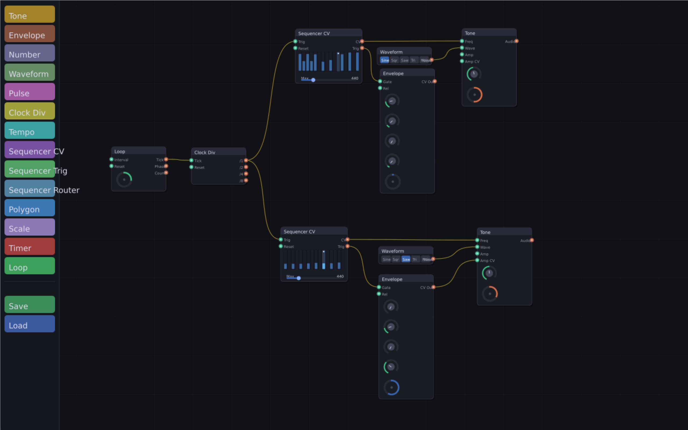

# AVVPL — Audio/Visual Visual Programming Language

A node graph editor for building audio signal chains, written in C++ with SDL3 and ThorVG.

Its still very much a work in progress. Contributions from those interested in helping out are welcome and appreciated.





## Building

Requires: CMake 3.25+, Ninja, Meson, a C++17 compiler.

```bash
cmake -B build -G Ninja
cmake --build build
./build/AVVPL
```

Dependencies are fetched automatically: SDL3, ThorVG (built via Meson), nlohmann/json.

## Controls

| Input | Action |
|---|---|
| Left-click drag on title bar | Move node |
| Left-click drag from socket | Draw wire |
| Right-click on node | Delete node |
| Right-click on socket | Disconnect socket |
| Right-click near wire | Delete wire |
| Middle-click drag | Pan canvas |
| Scroll wheel | Zoom canvas |
| Ctrl+S | Save graph to `graph.json` |
| Ctrl+O | Load graph from `graph.json` |
| Escape | Quit |

## Nodes

### Sound

| Node | Description |
|---|---|
| **Tone** | Synthesises audio from Freq, Waveform, Amp, and Detune inputs via SDL audio |
| **Waveform** | Discrete waveform type selector (Sine / Square / Saw / Triangle / Noise) |
| **Scope** | Oscilloscope of the graph's audio output: the summed signal of every Tone node, red when clipping. Time slider sets the span (1–90 ms) |
| **Envelope** | ADSR envelope — outputs a 0–1 CV curve on each Gate trigger |

### Clocking & Timing

| Node | Description |
|---|---|
| **Tempo** | BPM slider with Swing dial; outputs Tick (8th note) and Beat (quarter note) triggers |
| **Clock Div** | Divides a master clock into /1 /2 /4 /8 trigger outputs |
| **Loop** | Fires a Tick at a set interval; also outputs Phase (0–1) and Count |
| **Timer** | One-shot countdown; fires a Done trigger when it reaches zero |
| **Pulse** | Converts a trigger to a timed gate with Gate and Release outputs |

### Sequencers

| Node | Description |
|---|---|
| **Sequencer CV** | 16-step lane; CV output scaled by Max slider, plus a Trig output per active step |
| **Sequencer Trig** | 16-step gate sequencer; each step toggles on/off, fires Trig output when on |
| **Sequencer Router** | 16-step sequencer with one dedicated Trig output per step (outputs 1–16) |

### Utilities

| Node | Description |
|---|---|
| **Number** | Scalar float output via a slider |
| **Scale** | Maps an input float from one range to another (clamps to input range) |
| **Button** | Clickable pad; Trig fires on press, Rel on release. Wire Trig into Reset inputs to restart a tune |
| **Polygon** | Displays a regular polygon driven by Sides, Radius, and Rotation CV inputs |

## Example patch — sequenced melody

```
Tempo (Tick) ──► Sequencer CV (Trig in)
Sequencer CV (CV out) ──► Tone (Freq)
Sequencer CV (Trig out) ──► Envelope (Gate)
Envelope (CV out) ──► Tone (Amp)
Waveform ──► Tone (Waveform)
```

Set the Sequencer CV Max to 880 for a one-octave range. Set Envelope sustain to 0 for a piano-like decay.

## Architecture

```
src/
  main.cpp                — SDL3 setup, node registration, event loop
  ui/
    types.h               — Vec2, Color4, Value (float + trigger bool), palette colours
    widget.h/.cpp         — Base widget: world coords, hit test, draw, child tree
    socket.h              — Socket widget: input/output, Value propagation
    wire_layer.h/.cpp     — Wire storage, draft wiring, propagation, hit detection
    node.h/.cpp           — Draggable node container, socket layout, title drawing
    node_canvas.h/.cpp    — Canvas: owns nodes + wire layer, tick/render loop, pan/zoom
    node_registry.h       — Factory registry for save/load and palette
    graph_io.h/.cpp       — JSON save and load
    palette.h/.cpp        — Left-panel node spawner
    slider.h/.cpp         — Horizontal value slider
    dial.h/.cpp           — Rotary dial
    histogram.h/.cpp      — Editable bar array
    selector.h            — Row of labelled toggle buttons
    tone_node.h/.cpp      — ToneNode with SDL audio stream
    envelope_node.h       — EnvelopeNode ADSR
    timer_node.h          — TimerNode and LoopTimerNode
    tempo_node.h          — TempoNode with BPM and swing
    clock_div_node.h      — ClockDivNode
    pulse_node.h          — PulseNode
    step_seq_node.h       — Sequencer CV (StepLaneWidget + StepSeqNode)
    trig_seq_node.h       — Sequencer Trig (GateLaneWidget + TrigSeqNode)
    step_router_node.h    — Sequencer Router (StepIndicatorWidget + StepRouterNode)
    number_node.h         — NumberNode
    waveform_node.h       — WaveformNode
    scale_node.h          — ScaleNode
    poly_node.h           — PolyNode with live polygon display
```

**Tick order each frame:** clear output triggers → tick all nodes → propagate wires.  
Input triggers persist one frame (set by propagation, read by the receiving node next tick).
